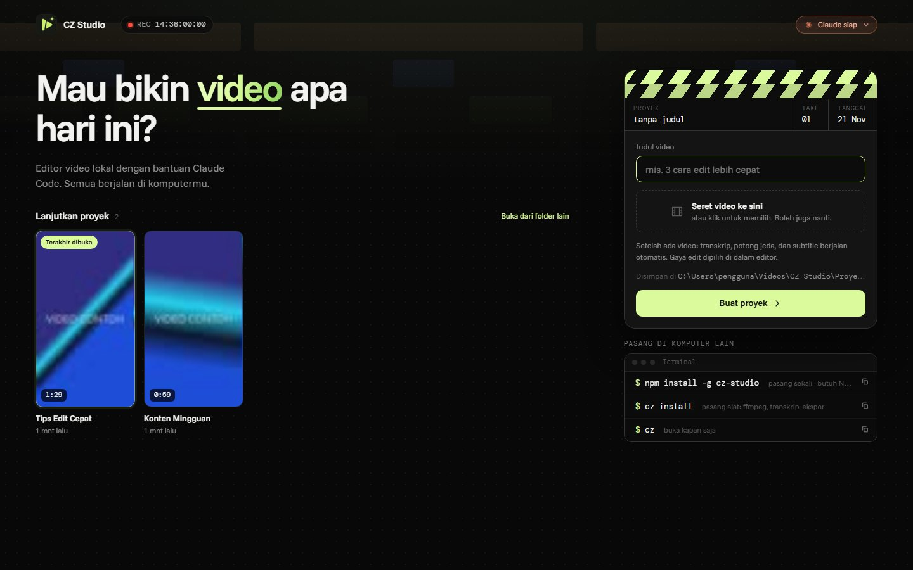
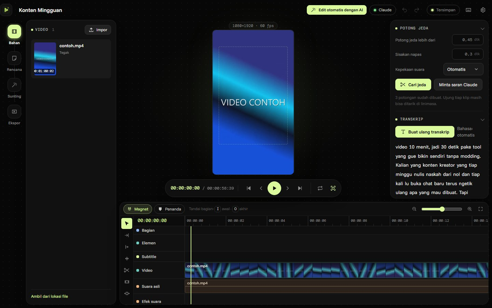
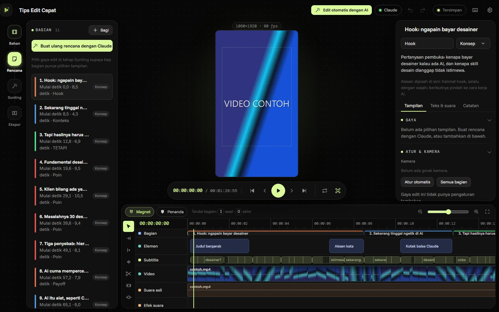
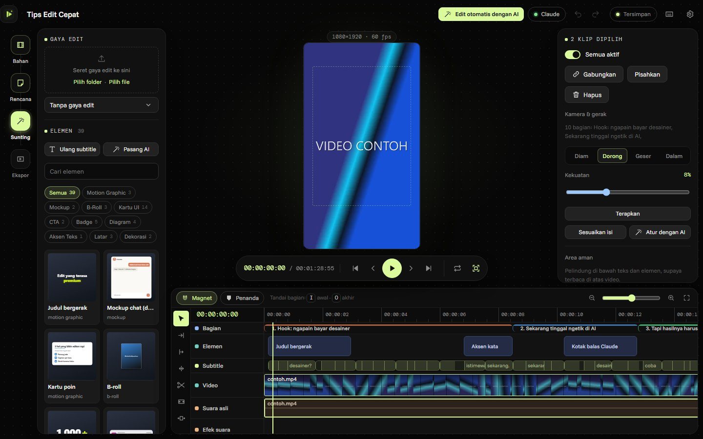
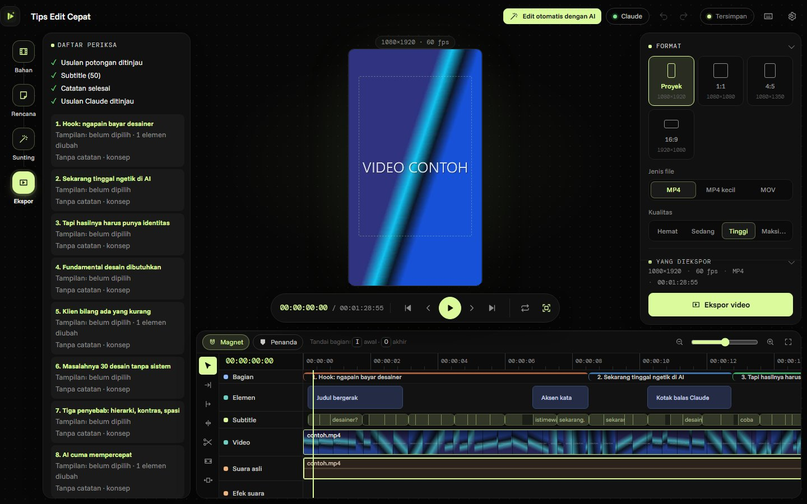

# CZ Studio

Editor video lokal untuk konten vertikal (Reels, TikTok, Shorts), dipasang lewat npm dan dibuka di browser. Impor video, potong jeda dan transkrip otomatis, susun per bagian, tambah subtitle, elemen bergerak, dan kamera, lalu ekspor. Fitur AI dijalankan oleh **Claude Code milikmu sendiri**.

- **Lokal penuh.** Server hanya berjalan di `127.0.0.1`. Footage, proyek, dan hasil ekspor tidak keluar dari komputermu.
- **Tanpa API key.** CZ tidak menyimpan kunci apa pun dan tidak punya server AI. Pemakaian AI dihitung ke login Claude-mu.
- **Footage asli tidak diubah.** Potongan hanya titik masuk dan keluar.
- **Semua bisa dibatalkan** dengan Ctrl+Z, baik perubahan darimu maupun dari Claude.



## Fitur

- **Otomatis saat video masuk:** transkrip per kata (whisper.cpp), potong jeda, subtitle per kata, dan deteksi wajah.
- **Timeline ala Premiere:** magnet, penanda, tanda masuk/keluar, gunting, geser isi klip, dan zoom linimasa.
- **Rencana per bagian:** video dibagi per konteks, lengkap dengan gaya, catatan revisi, dan riwayat.
- **Elemen bergerak:** elemen berupa kode yang bergerak (bukan gambar) dan bisa digeser langsung di pratinjau. Pustaka elemen bawaan tidak ikut paket publik; elemen datang dari skill yang Anda pasang.
- **Kamera dan gerak:** setiap gerakan masuk, bertahan, lalu keluar. Bisa diatur manual, otomatis dari isi ucapan dan posisi wajah, atau lewat Claude.
- **Area aman atas dan bawah:** pelindung teks berupa gradasi gelap, blur, atau kontras, dengan kekuatan dan tinggi yang bisa diatur.
- **Teks dan elemen di belakang kepala:** orang di video menutupi elemen atau subtitle, memakai potongan subjek yang dibuat CZ.
- **Skill:** skill membawa komposisi, menu kustom, dan aset sendiri. Gaya apa pun bisa diterapkan ke semua bagian sekaligus.
- **Ekspor:** MP4 (H.264 atau H.265) dan MOV ProRes, beberapa rasio layar, motion blur, dan suara diratakan ke −14 LUFS.

## Yang wajib ada

| Kebutuhan | Keterangan |
| --- | --- |
| **Sistem operasi** | Windows 10/11 (didukung penuh). macOS dan Linux belum diuji; ffmpeg dan whisper-cli harus dipasang manual |
| **Node.js** | versi 20 atau lebih baru |
| **Python** | 3.10 sampai 3.13, untuk deteksi wajah dan potongan subjek. Tanpa Python, fitur itu tidak aktif, yang lain tetap jalan |
| **Ruang dan koneksi** | sekitar 650 MB unduhan sekali di awal dan ±1 GB ruang kosong. Setelah itu CZ jalan tanpa internet, kecuali fitur AI |
| **Akun Claude** (opsional) | langganan Pro atau Max untuk fitur AI. Tanpa Claude, impor, potong jeda, sunting, dan ekspor tetap jalan |

## Pasang

**1. Pasang Node.js** (versi LTS) dari [nodejs.org](https://nodejs.org). Cek di PowerShell atau Terminal:

```
node -v
```

**2. Pasang CZ Studio.**

```
npm install -g cz-studio
```

**3. Pasang semua alatnya.**

```
cz install
```

Perintah ini memasang ffmpeg dan ffprobe, whisper-cli beserta model transkrip, aset bawaan, mesin ekspor (Chrome Headless), mesin skrip Python dengan modelnya (wajah dan potongan subjek), dan Claude Code. Alat yang sudah ada dilewati, jadi aman dijalankan ulang.

Jalankan langkah ini sendiri. npm versi terbaru memblokir skrip pemasangan secara bawaan, jadi `npm install -g cz-studio` bisa selesai tanpa memasang alat apa pun. Kalau terlewat, CZ juga menyiapkan alat yang kurang di latar saat pertama dibuka.

Setelah selesai, `cz install` menampilkan ringkasan: apa yang sudah siap dan apa yang masih perlu Anda kerjakan sendiri (mis. memasang Python atau login Claude Code). Kalau Anda langsung menjalankan `cz` sebelum itu, CZ menampilkan langkah berikutnya yang sama di terminal.

Transisi dan efek suara (SFX) terpasang otomatis di tiap sambungan footage tanpa Claude. Keduanya tampil sebagai penanda ◆ (transisi) dan ♪ (SFX) di track video; klik penandanya untuk mengganti atau mematikannya. SFX bawaan dibuat saat `cz install` (butuh ffmpeg).

Dua langkah akan **bertanya dulu** sebelum mengubah komputermu: memasang Python lewat winget (bila belum ada) dan memasang Claude Code secara global lewat npm. Jawab `y` untuk setuju. Pemasangan otomatis lewat `npm install` tidak pernah menyetujuinya sendiri.

**4. Buka CZ.**

```
cz
```

Beranda terbuka di browser. Buat proyek, seret video, selesai.

**5. (Opsional) Hubungkan Claude.** Tekan *Masuk ke Claude* di beranda dan login di jendela yang terbuka.

Cek semuanya dengan `cz doctor`, dan perbarui dengan `cz update`.

### Keamanan pemasangan

Semua unduhan alat lewat HTTPS dan **diverifikasi SHA-256 beserta ukurannya**. File yang tidak cocok langsung dibuang dan pemasangan berhenti dengan pesan jelas. ffmpeg dan whisper-cli dikunci ke satu rilis tertentu, dan paket Python dibatasi sampai versi mayor berikutnya.

## Perintah

| Perintah | Fungsi |
| --- | --- |
| `cz` | Buka beranda di browser |
| `cz open "<folder proyek>"` | Buka proyek |
| `cz new "<folder>" [--title "<judul>"] [--video "<file>"] [--skill <id>]` | Buat proyek |
| `cz skill add "<folder skill atau .zip>"` | Tambah skill editing |
| `cz render "<folder proyek>" [--preset 9:16\|1:1\|4:5\|16:9] [--codec h264\|h265\|prores]` | Ekspor tanpa browser |
| `cz install` | Pasang semua alat yang belum ada (sama dengan `cz setup`) |
| `cz models install [--model small-q5_1\|small\|medium\|base]` | Ganti atau tambah model transkrip |
| `cz doctor` | Cek Node, ffmpeg, Claude Code, model, port |
| `cz update` | Perbarui ke versi terbaru |

Opsi umum: `--port 4317`, `--no-open`, `--data "<folder data>"` (bawaan `%USERPROFILE%\.cz-studio`). Folder data terpisah berguna untuk mencoba CZ dari nol tanpa menyentuh data yang ada.

## Alur kerja

Empat tahap di rel kiri membaca dan menulis proyek yang sama.

### 1. Bahan

Seret video. Pratinjau, transkrip, potong jeda, subtitle, dan deteksi wajah berjalan otomatis di latar. Tinjau usulan potongan, lalu potong. Menghapus kata di transkrip ikut memotong videonya.



### 2. Rencana

Bagi video per konteks, sendiri atau dengan Claude. Atur tampilan, teks, efek suara, dan catatan tiap bagian.



### 3. Sunting

Pilih skill, seret elemen ke pratinjau atau linimasa, lalu atur kamera, area aman, dan posisi elemen.



### 4. Ekspor

Pilih format, kualitas, dan rentang. CZ memeriksa catatan yang belum selesai dan elemen yang keluar batas aman sebelum mulai. Hasil masuk folder `render/` proyek.



## Lisensi

CZ Studio dirilis dengan **lisensi MIT**. Lihat [LICENSE](LICENSE). Hak cipta © 2026 Azmi.

### Terima kasih dan lisensi pihak ketiga

CZ Studio berdiri di atas karya banyak orang. Mohon hormati lisensi mereka, terutama bila kamu membagikan atau memakainya secara komersial. Daftar ini ringkasan, jadi baca lisensi resmi di sumbernya untuk syarat lengkap dan terbaru.

| Komponen | Pembuat | Lisensi | Catatan |
| --- | --- | --- | --- |
| [Remotion](https://remotion.dev) | Remotion | Lisensi Remotion | **Syarat khusus.** Gratis untuk individu dan tim kecil. Perusahaan di atas batas yang ditentukan wajib membeli lisensi. Baca [remotion.dev/license](https://remotion.dev/license) sebelum memakai CZ Studio di perusahaan atau membagikannya |
| Kit gerak (`packages/composition/src/motion`) | Yahia Zahran (Zahran Motion) | MIT | Lisensi asli ada di [LICENSE-zahran-ui-motion.txt](packages/composition/src/motion/LICENSE-zahran-ui-motion.txt) |
| [whisper.cpp](https://github.com/ggml-org/whisper.cpp) dan model Whisper | Georgi Gerganov dan kontributor, OpenAI | MIT | transkrip lokal |
| [FFmpeg](https://ffmpeg.org) | Proyek FFmpeg. Build Windows dari [GyanD/codexffmpeg](https://github.com/GyanD/codexffmpeg) | LGPL/GPL (build *essentials* berlisensi GPL) | diunduh `cz install`, tidak disertakan di repo |
| [OpenCV](https://opencv.org) dan model YuNet ([opencv_zoo](https://github.com/opencv/opencv_zoo)) | OpenCV, Shiqi Yu | Apache-2.0 (OpenCV), MIT (YuNet) | deteksi wajah |
| [U²-Net](https://github.com/xuebinqin/U-2-Net) (bobot lewat [rembg](https://github.com/danielgatis/rembg)) | Xuebin Qin, Daniel Gatis | Apache-2.0 (U²-Net), MIT (rembg) | potongan subjek |
| [ONNX Runtime](https://onnxruntime.ai), [NumPy](https://numpy.org), [Pillow](https://python-pillow.org), [SoundFile](https://github.com/bastibe/python-soundfile) | Microsoft, komunitas masing-masing | MIT, BSD, HPND, BSD | paket Python |
| [Fastify](https://fastify.dev), [esbuild](https://esbuild.github.io), [Immer](https://immerjs.github.io/immer/), [React](https://react.dev), [Vite](https://vitejs.dev) | komunitas masing-masing | MIT | pustaka program |
| Font bawaan | [Google Fonts](https://github.com/google/fonts) dan perancangnya | SIL OFL 1.1 | diunduh `cz install` |
| [Claude Code](https://claude.com/claude-code) | Anthropic | Ketentuan Anthropic | opsional, dipasang dan dimasuki akunnya oleh pengguna |

Efek suara dan font yang dibawa sebuah skill tunduk pada lisensi skill itu. Kalau kamu membuat atau membagikan skill, cantumkan lisensi dan pembuat aset di dalamnya.

Kalau ada karya yang dipakai di sini tetapi belum tercantum dengan benar, atau lisensinya salah ditulis, buka *issue* dan akan segera diperbaiki.
